  

# 🏢 Awesome Team Workspace & Information Hub 🚀 📚

  
  
  
  
  
  
  

> 🌟 A curated directory and architectural guide to top **Team Workspace**, **Internal Knowledge Base**, and **Enterprise Information Hub** platforms — comparing commercial SaaS collaboration hubs and self-hosted open-source wiki alternatives for structuring team documentation, project management, and asynchronous collaboration. 💼 💡
> 
> ⭐ *Star this repository if you find it helpful!* ⭐

---

## 📋 Table of Contents 📑

- [🌐 Sector Overview & Market Dynamics](#-sector-overview--market-dynamics-)
- [🟦 SaaS / Hosted Platforms](#-saas--hosted-platforms-)
- [🟩 Open-Source Software](#-open-source-software-)
- [📊 Comparison at a Glance](#-comparison-at-a-glance-)
- [💖 Support & Community](#-support--community-)
- [📈 Star History](#-star-history-)
- [🤝 Contributing](#-contributing-)
- [📄 License](#-license-)

---

## 🌐 Sector Overview & Market Dynamics 📈

The global team collaboration and knowledge management software market is valued at approximately **$44.6 billion in 2026** (projected to exceed $85 billion by the early 2030s at a ~9.7%–13.6% CAGR), propelled by hybrid workplace models and AI-driven retrieval-augmented generation (RAG) capabilities. The sector is **moderately fragmented**: while hyperscale enterprise incumbents (Microsoft 365 / SharePoint and Atlassian Confluence) dominate large enterprise IT deployments, fast-growing modular suites (Notion, ClickUp, Coda) and privacy-focused open-source platforms retain substantial independent market share, preventing a single winner-take-all outcome.

---

## 🟦 SaaS / Hosted Platforms ☁️

The table below outlines leading commercial cloud-hosted team workspace platforms, sorted in descending order by parent company scale (market capitalization / valuation):

| Product | Company Scale (Revenue / Valuation) | Starting Tier Pricing | Free Tier Limits / Free Trial | Primary Focus & Capabilities |
|:---|:---|:---|:---|:---|
| **Microsoft SharePoint** | ~$3.1 Trillion Market Cap (Microsoft Corporation / FY24 Rev $245B) | **$6.00 / user / month** (Microsoft 365 Business Basic, annual commitment) | **30-day free trial** with full feature access (capped up to 300 users; requires sign-up verification) | Enterprise document lifecycle governance, intranet portals, and deep native Microsoft 365 / Teams ecosystem integration. |
| **Confluence** | ~$60 Billion Market Cap (Atlassian Corporation / FY24 Rev $4.4B) | **$5.42 / user / month** (Standard Plan, billed annually; or $6.05/user/mo billed monthly) | **Free forever up to 10 users**; includes 2 GB total file storage, unlimited spaces/pages, and standard community support. | Governed engineering and product documentation spaces with bi-directional Jira/Bitbucket issue linking and sprint runbooks. |
| **Basecamp** | ~$100 Million+ Est. Annual Revenue (37signals / Bootstrapped & highly profitable) | **$15.00 / user / month** (billed annually) or $29/mo (Freelancer flat tier for up to 5 users) | **30-day free trial** (all Pro features included, no credit card required); **Free forever Personal plan** capped at 3 users, 1 active project, and 1 GB storage. | Opinionated project communication, message boards, to-dos, schedules, and document storage without workspace setup complexity. |
| **Notion** | ~$10 Billion Private Valuation (Est. ARR $250M–$300M+) | **$10.00 / user / month** (Plus Plan, billed annually; or $12/user/mo billed monthly) | **Free forever for individual use**; includes unlimited pages/blocks, up to 10 guest collaborators, 5 MB file upload limit, and 7-day version history. | Highly flexible block-based workspace unifying docs, relational databases, wikis, and lightweight project management. |
| **ClickUp** | ~$4.0 Billion Valuation (Series C / Est. ARR $150M+) | **$7.00 / user / month** (Unlimited Plan, billed annually; or $10/user/mo billed monthly) | **Free forever with unlimited members & tasks**; limited to 100 MB total cloud storage, 100 automation runs/mo, and standard workspace views. | All-in-one productivity suite bundling task lists, sprint docs, whiteboard ideation, goal tracking, and time management. |
| **Coda** | ~$1.4 Billion Valuation (Series D / Est. ARR $40M–$50M) | **$10.00 / Doc Maker / month** (Pro Plan, billed annually; or $12/maker/mo billed monthly; Readers & Editors are free) | **Free forever with unlimited Doc Makers and team members**; capped by document size (limited rows and objects per doc), 7-day version history. | Canvas-first docs powered by structured formulas, connected relational tables, and third-party API Pack automations. |
| **Guru** | ~$500 Million Valuation (Series C / Est. ARR $30M–$40M) | **$25.00 / user / month** (All-in-One Plan, billed annually with a mandatory 10-seat floor: $250/mo minimum) | **30-day free trial** with full knowledge-verification workflows; customized proof-of-concept trial environments available. | AI-powered enterprise search and automated knowledge verification delivered directly inside Slack, Teams, and web browsers. |
| **Slab** | ~$50 Million Valuation (Est. Seed/Series A / Est. ARR $5M–$10M) | **$6.67 / user / month** (Startup Plan, billed annually; or $8/user/mo billed monthly) | **Free forever up to 10 users**; includes 90-day version history, 10 MB per file upload limit, unlimited posts, and unified search. | Lightweight, distraction-free knowledge hub emphasizing fast search and real-time syncing across Google Docs, GitHub, and Slack. |

---

## 🟩 Open-Source Software 🔓

Self-hosted, community-driven team workspaces, documentation hubs, and collaborative wiki frameworks. The repositories below are sorted in **descending order of GitHub Stars_Count**:

### 1. AppFlowy 📱

- **Repository:** [AppFlowy-IO/AppFlowy](https://github.com/AppFlowy-IO/AppFlowy)
- **Tech Stack:** Flutter / Rust / PostgreSQL / Redis / S3
- **License:** AGPL-3.0
- **Overview:** AppFlowy is the leading open-source alternative to Notion, built with Flutter and Rust for high performance. It provides complete data ownership with docs, relational databases (grid, kanban, calendar, gallery views), offline-first capabilities, and self-hosted cloud sync.

### 2. AFFiNE 🎨

- **Repository:** [toeverything/AFFiNE](https://github.com/toeverything/AFFiNE)
- **Tech Stack:** TypeScript / Rust (OctoBase) / React
- **License:** MIT (Community Edition)
- **Overview:** AFFiNE integrates structured block documents, relational databases, and an infinite whiteboard canvas (Miro-style) into a single workspace. It supports local-first data storage, CRDT-based real-time synchronization, and multi-modal AI copilot workflows.

### 3. Plane ✈️

- **Repository:** [makeplane/plane](https://github.com/makeplane/plane)
- **Tech Stack:** Python (Django) / TypeScript / Next.js / PostgreSQL / Redis
- **License:** AGPL-3.0
- **Overview:** Plane is an open-source work management and team information hub designed as an alternative to Jira, Linear, and ClickUp. It offers issue tracking, cycles, modules, project documentation pages, and team velocity analytics.

### 4. Outline 📝

- **Repository:** [outline/outline](https://github.com/outline/outline)
- **Tech Stack:** Node.js / React / PostgreSQL / Redis / S3
- **License:** BSL 1.1
- **Overview:** Outline provides a polished, Notion-like Markdown wiki tailored for high-growth tech teams. Features include sub-second full-text search, collaborative real-time editing, enterprise OIDC/SAML authentication, rich API integrations, and fine-grained collection permissions.

### 5. Mattermost 💬

- **Repository:** [mattermost/mattermost](https://github.com/mattermost/mattermost)
- **Tech Stack:** Go / React / PostgreSQL / MySQL
- **License:** AGPL-3.0 / Apache-2.0
- **Overview:** An open-source enterprise collaboration hub combining secure team messaging, multi-channel discussions, workflow playbooks, and Kanban boards (Focalboard integration) into an integrated, self-hostable command center.

### 6. Trilium 🌳

- **Repository:** [TriliumNext/Trilium](https://github.com/TriliumNext/Trilium)
- **Tech Stack:** JavaScript (Node.js) / SQLite
- **License:** AGPL-3.0
- **Overview:** A hierarchical knowledge base designed for building deeply linked personal and team knowledge trees. It features rich-text WYSIWYG note editing, source code syntax highlighting, mind maps, attribute relations, and fast internal encryption.

### 7. Nextcloud ☁️

- **Repository:** [nextcloud/server](https://github.com/nextcloud/server)
- **Tech Stack:** PHP / JavaScript / MySQL / PostgreSQL / Redis
- **License:** AGPL-3.0
- **Overview:** The self-hosted productivity ecosystem providing file syncing (SharePoint alternative), real-time collaborative document editing via Nextcloud Office (LibreOffice/Collabora/ONLYOFFICE), Nextcloud Deck kanban boards, and team calendars.

### 8. Wiki.js 🌐

- **Repository:** [requarks/wiki](https://github.com/requarks/wiki)
- **Tech Stack:** Node.js / Vue.js / Multi-Engine (PostgreSQL, MySQL, SQLite)
- **License:** AGPL-3.0
- **Overview:** Modern, extensible open-source wiki engine featuring Git-backed two-way storage syncing, multi-format editors (Markdown, Visual, Code, AsciiDoc), and 40+ authentication integrations (LDAP, SAML, OAuth, Okta, Azure AD).

### 9. Docmost 📚

- **Repository:** [docmost/docmost](https://github.com/docmost/docmost)
- **Tech Stack:** Node.js / NestJS / React / PostgreSQL / Redis
- **License:** AGPL-3.0
- **Overview:** Modern open-source Confluence alternative featuring nested document spaces, real-time multi-user collaborative editing, built-in email/password authentication, granular access permissions, and native diagramming (Draw.io, Excalidraw, Mermaid).

### 10. BookStack 📖

- **Repository:** [BookStackApp/BookStack](https://github.com/BookStackApp/BookStack)
- **Tech Stack:** PHP (Laravel) / MySQL
- **License:** MIT
- **Overview:** An intuitive documentation engine designed around a simple hierarchy: Shelves → Books → Chapters → Pages. Features include dual WYSIWYG and Markdown editors, integrated diagrams.net drawing, role-based access control, and built-in full-text search.

### 11. Etherpad ✍️

- **Repository:** [ether/etherpad-lite](https://github.com/ether/etherpad-lite)
- **Tech Stack:** Node.js / JavaScript / Multi-DB
- **License:** Apache-2.0
- **Overview:** A real-time collaborative web editor engine allowing multiple team members to co-author notes, agendas, and technical documents simultaneously with sub-second synchronization and extensive plugin extensibility.

### 12. Gollum 🐙

- **Repository:** [gollum/gollum](https://github.com/gollum/gollum)
- **Tech Stack:** Ruby / Git / Rugged
- **License:** MIT
- **Overview:** A lightweight, Git-powered wiki engine backed directly by standard Git repositories. Pages are stored as plain Markdown, Org, or AsciiDoc files, allowing edits via both a clean web interface and command-line Git commits.

### 13. Anytype 🔒

- **Repository:** [anyproto/anytype-ts](https://github.com/anyproto/anytype-ts)
- **Tech Stack:** TypeScript / Go (Any-Sync) / SQLite
- **License:** Any Source Available License (Open Source ecosystem)
- **Overview:** A local-first, peer-to-peer workspace based on an object-oriented graph model. It encrypts all team data end-to-end and combines documents, databases, task lists, and visual relation graphs with offline execution.

### 14. CryptPad 🛡️

- **Repository:** [cryptpad/cryptpad](https://github.com/cryptpad/cryptpad)
- **Tech Stack:** JavaScript (Node.js) / Cryptographic WASM
- **License:** AGPL-3.0
- **Overview:** An end-to-end encrypted collaborative workspace suite offering rich text documents, spreadsheets, code editors, kanban boards, presentations, and whiteboards where content is client-side encrypted before storage.

### 15. DokuWiki 📑

- **Repository:** [dokuwiki/dokuwiki](https://github.com/dokuwiki/dokuwiki)
- **Tech Stack:** PHP / Flat Files (No Database required)
- **License:** GPL-2.0
- **Overview:** Standard flat-file wiki requiring no external database backend. Highly resilient and maintenance-free, featuring role-based ACLs, built-in authentication connectors, full revision history, and thousands of community plugins.

### 16. GROWI 🌱

- **Repository:** [growilabs/growi](https://github.com/growilabs/growi)
- **Tech Stack:** TypeScript / Node.js / React / MongoDB / Elasticsearch
- **License:** MIT
- **Overview:** Hierarchical Markdown-native team wiki with path-based page routing, Yjs-backed collaborative real-time editing, Passkey/SAML/LDAP sign-on, and GROWI Vault (Git-backed page export for LLM ingestion).

### 17. XWiki 🏛️

- **Repository:** [xwiki/xwiki-platform](https://github.com/xwiki/xwiki-platform)
- **Tech Stack:** Java / Solr / MySQL / PostgreSQL
- **License:** LGPL-2.1
- **Overview:** A battle-tested enterprise wiki and collaborative app platform with document hierarchies, granular permission schemes, Confluence migration tooling, and extension capabilities using scripting macros (Groovy, Velocity).

### 18. Folio 📄

- **Repository:** [evergreen-it-dev/folio](https://github.com/evergreen-it-dev/folio)
- **Tech Stack:** TypeScript / Next.js / Git-backed
- **License:** AGPL-3.0
- **Overview:** AI-assisted, Git-native team wiki where pages and workspace configs live in Git. Each space includes a `.agent` directory where instructions for space AI assistants are authored as ordinary Markdown pages.

### 19. OneCamp ⛺

- **Repository:** [OneMana-Soft/OneCamp](https://github.com/OneMana-Soft/OneCamp)
- **Tech Stack:** Go / Next.js / LiveKit / Tiptap / PostgreSQL
- **License:** AGPL-3.0
- **Overview:** Self-hosted all-in-one team workspace consolidating persistent team chat channels, task boards, collaborative documents, whiteboards, calendar scheduling, and WebRTC video conferencing into a unified PWA.

---

## 📊 Comparison at a Glance 🔍

| Platform | Deployment | License | Primary Stack | Real-Time Sync | Git-Backed | Best Suited For |
|:---|:---|:---|:---|:---:|:---:|:---|
| **Microsoft SharePoint** | Cloud / On-Prem | Commercial | Microsoft 365 / Azure | ✅ | ❌ | Enterprise records & MS Office governance |
| **Confluence** | Cloud / Data Center | Commercial | Java / Cloud | ✅ | ❌ | Structured Jira-integrated technical specs |
| **Basecamp** | Cloud | Commercial | Ruby on Rails | ✅ | ❌ | High-level project comms & agency client work |
| **Notion** | Cloud | Commercial | React / TypeScript | ✅ | ❌ | Flexible relational databases & team wikis |
| **ClickUp** | Cloud | Commercial | Angular / TypeScript | ✅ | ❌ | Unified task, goal, and documentation hubs |
| **Coda** | Cloud | Commercial | React / WebAssembly | ✅ | ❌ | Formula-driven interactive document apps |
| **Guru** | Cloud | Commercial | Cloud Services | ✅ | ❌ | In-workflow verified knowledge answers |
| **Slab** | Cloud | Commercial | React / Node.js | ✅ | ❌ | Streamlined internal team wiki and search |
| **AppFlowy** | Self-Hosted / Cloud | AGPL-3.0 | Flutter / Rust | ✅ | ❌ | Local-first Notion alternative |
| **AFFiNE** | Self-Hosted / Cloud | MIT | TypeScript / Rust | ✅ | ❌ | Unified docs, whiteboard & kanban canvas |
| **Plane** | Self-Hosted / Cloud | AGPL-3.0 | Python / TypeScript | ✅ | ❌ | Agile project management and doc hubs |
| **Outline** | Self-Hosted / Cloud | BSL 1.1 | Node.js / React | ✅ | ❌ | Polished high-speed team Markdown wiki |
| **Mattermost** | Self-Hosted / Cloud | AGPL-3.0 | Go / React | ✅ | ❌ | Secure team communications and playbooks |
| **Trilium** | Self-Hosted | AGPL-3.0 | Node.js / SQLite | ✅ | ❌ | Deep hierarchical note-taking trees |
| **Nextcloud** | Self-Hosted | AGPL-3.0 | PHP / MySQL | ✅ | ❌ | Self-hosted Google Drive / SharePoint suite |
| **Wiki.js** | Self-Hosted | AGPL-3.0 | Node.js / Vue.js | ❌ | ✅ | Developer-friendly Git-synced wiki |
| **Docmost** | Self-Hosted / Cloud | AGPL-3.0 | NestJS / React | ✅ | ❌ | Out-of-the-box self-hosted Confluence alternative |
| **BookStack** | Self-Hosted | MIT | PHP (Laravel) | ❌ | ❌ | Organized non-technical company documentation |
| **Etherpad** | Self-Hosted | Apache-2.0 | Node.js | ✅ | ❌ | Low-latency collaborative document scratchpad |
| **Gollum** | Self-Hosted | MIT | Ruby / Git | ❌ | ✅ | Pure Git-backed Markdown wiki engine |
| **Anytype** | Local / P2P | Open Source | TypeScript / Go | ✅ | ❌ | Private encrypted local-first graph notes |
| **CryptPad** | Self-Hosted / Cloud | AGPL-3.0 | JavaScript / WASM | ✅ | ❌ | Zero-knowledge encrypted collaborative suite |
| **DokuWiki** | Self-Hosted | GPL-2.0 | PHP (Flat-file) | ❌ | ❌ | Lightweight, maintenance-free flat-file wiki |
| **GROWI** | Self-Hosted | MIT | Node.js / MongoDB | ✅ | ✅ (Vault) | Markdown-first engineering wiki with AI search |
| **XWiki** | Self-Hosted / Cloud | LGPL-2.1 | Java / Solr | ✅ | ❌ | Heavyweight extensible enterprise wiki |
| **Folio** | Self-Hosted | AGPL-3.0 | Next.js / Git | ✅ | ✅ | Git-native team wiki with versioned AI agents |
| **OneCamp** | Self-Hosted | AGPL-3.0 | Go / Next.js | ✅ | ❌ | Consolidated chat, docs, and video workspace |

---

## 💖 Support & Community 🌟

Thank you for visiting and using this curated guide to Team Workspaces and Enterprise Information Hubs! If you find this directory helpful:

- ⭐ **Star this repository** on GitHub to help other engineers, managers, and teams discover modern workspace tooling.
- 🍴 **Fork the repository** to contribute new benchmarks, documentation, or open-source solutions.
- 📢 **Share with colleagues** across developer, product, and DevOps communities on LinkedIn, X/Twitter, or Reddit.
- ☕ **Buy a coffee & sponsor ongoing research:**  
    
  Support directly through the [GitHub Sponsor Dashboard](https://github.com/sponsors/ishandutta2007)! Every contribution is deeply appreciated.

---

##  Star History

---

## 🤝 Contributing 👥

Contributions are warmly welcomed! If you know of an actively maintained open-source Team Workspace, Wiki, or Information Hub:

1. Fork the repository.
2. Ensure the project is actively maintained (active releases or commits within the last 12 months).
3. If adding an open-source project, include an official GitHub Stars_Badge formatted as `` and place it in the sorted descending star position.
4. If adding a SaaS product, specify exact starting tier pricing, free tier/trial limit parameters, and parent company scale metrics.
5. Submit a descriptive Pull Request.

---

## 📄 License ⚖️

This repository is curated and made available under the [Creative Commons Zero v1.0 Universal (CC0 1.0)](https://creativecommons.org/publicdomain/zero/1.0/) Public Domain Dedication. Individual tools and listed repositories retain their respective proprietary or open-source licenses.
